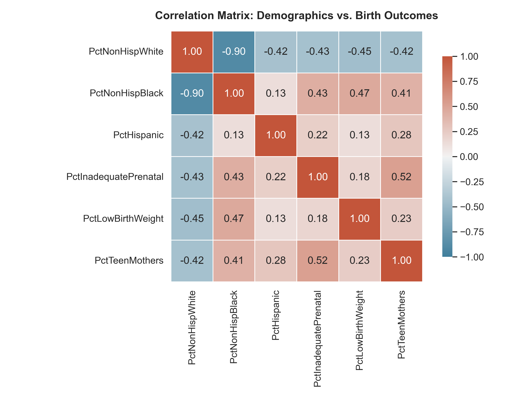
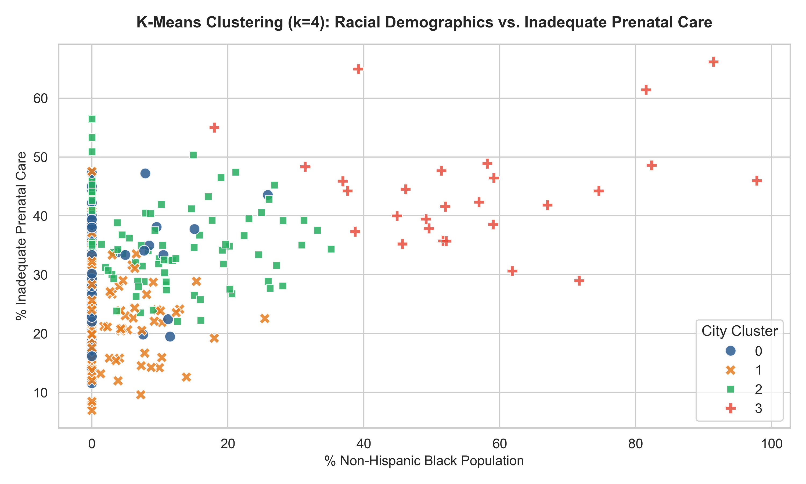
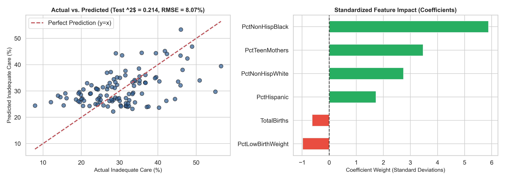

# Analysis of Birth Outcomes & Prenatal Care Disparities in Michigan (2014)

[](https://www.python.org/)
[](https://scikit-learn.org/)
[](https://pandas.pydata.org/)
[](https://jupyter.org/)
[](https://opensource.org/licenses/MIT)

An end-to-end data science investigation analyzing maternal health outcomes across Michigan municipalities. This project investigates whether demographic factors (specifically racial and ethnic distributions) can predict rates of **inadequate prenatal care**, utilizing exploratory data analysis (EDA), **unsupervised K-Means clustering**, and **supervised Multiple Linear Regression**.

---

## 📌 Executive Summary

* **Research Question**: *Can we accurately predict municipal rates of inadequate prenatal care in Michigan using demographic composition and birth outcome indicators?*
* **Core Findings**:
  * Strong racial disparities exist in prenatal healthcare access across Michigan cities.
  * Cities with higher proportions of African American residents exhibited statistically higher rates of inadequate prenatal care ($r = 0.50$).
  * **K-Means Clustering ($k=4$)** uncovered distinct municipal risk tiers, separating well-resourced homogeneous suburbs from structurally underserved urban centers.
  * **Multiple Linear Regression** explained **21.4% of the test variance** ($R^2 = 0.214$, $\text{RMSE} = 8.07\%$), highlighting that while demographic proxies are strongly indicative, structural determinants (such as clinic proximity, median household income, and insurance coverage) represent crucial unmeasured variables.

---

## 🔬 Methodology & Framework

The workflow follows the **5 Core Activities of Data Analysis** (*Peng & Matsui*):
1. **Stating and Refining the Question**: Formulated predictive and inferential hypotheses regarding healthcare disparity drivers.
2. **Exploring the Data**: Cleaned missing values, computed derived percentage metrics, filtered small-sample bias ($N \ge 50$ births), and produced correlation matrices.
3. **Statistical Modeling**:
   * *Unsupervised Learning*: $K$-Means clustering ($k=4$) on standardized demographic variables.
   * *Supervised Learning*: Multiple Linear Regression to quantify feature contributions.
4. **Interpreting Results**: Assessed statistical significance, coefficient weights, and model limitations.
5. **Communicating Results**: Actionable public health policy recommendations for state resource allocation.

---

## 📊 Key Findings & Visualizations

### 1. Demographic Correlation Heatmap
Analysis shows a notable positive correlation between `% Non-Hispanic Black` population and `% Inadequate Prenatal Care` ($r = 0.50$), as well as `% Teen Mothers` ($r = 0.50$).

<p align="center">
  
</p>

### 2. Unsupervised Clustering Profile ($k=4$)
Municipalities naturally clustered into 4 distinct socioeconomic and maternal health tiers:

| Cluster | Cities ($N$) | % White | % Black | % Hispanic | % Inadequate Care | % Low Birth Weight | Profile Summary |
| :---: | :---: | :---: | :---: | :---: | :---: | :---: | :--- |
| **0** | 107 | 91.4% | 1.2% | 1.6% | **28.6%** | 0.2% | Low-risk rural / suburban towns |
| **1** | 129 | 88.6% | 2.4% | 2.1% | **24.2%** | 8.3% | Moderate-size suburban areas |
| **2** | 104 | 75.3% | 9.6% | 9.1% | **35.6%** | 7.2% | Racially diverse mid-sized cities |
| **3** | 27 | 34.4% | 55.8% | 6.1% | **44.4%** | 12.2% | High-need urban centers (Detroit, Flint, etc.) |

<p align="center">
  
</p>

### 3. Predictive Modeling (Multiple Linear Regression)
* **Model Objective**: Predict `% Inadequate Prenatal Care`.
* **Test Performance**: $R^2 = 0.214$, $\text{RMSE} = 8.07\%$.

<p align="center">
  
</p>

* **Standardized Feature Importance**:
  * `PctNonHispBlack` (+5.89 standard deviations) had the largest positive impact on inadequate prenatal care rates.
  * `PctTeenMothers` (+3.47) and `PctNonHispWhite` (+2.74) followed.

---

## 🏛️ Public Health & Policy Implications

1. **Targeted State Funding**: State health departments should prioritize prenatal mobile clinics and transportation subsidies in **Cluster 3** municipalities.
2. **Teen Maternal Support**: The strong relationship between teen motherhood and late/inadequate care suggests high school-based health clinics could significantly reduce disparities.
3. **Beyond Race as a Predictor**: Demographics serve as a proxy for systemic disinvestment (healthcare deserts, lack of insurance, public transit limits). Incorporating ZIP-code level census income and hospital beds per capita is recommended for future versions.

---

## 📂 Project Structure

```bash
├── Final Project_YildizOsman.ipynb   # Complete analysis notebook with executed outputs
├── Births_byCity_2014.csv            # Michigan Department of Community Health 2014 dataset
├── requirements.txt                  # Python dependencies
├── .gitignore                        # Git configuration to exclude temporary files
├── README.md                         # Project documentation & portfolio presentation
├── Executive_Summary_Report.md       # Formal written report deliverable
└── assets/                           # High-resolution charts & figures
    ├── correlation_heatmap.png
    ├── cluster_analysis.png
    └── regression_performance.png
```

---

## 🚀 How to Run Locally

### 1. Clone the repository
```bash
git clone https://github.com/<oseyosman>/michigan-birth-outcomes-analysis.git
cd michigan-birth-outcomes-analysis
```

### 2. Set up virtual environment
```bash
python3 -m venv venv
source venv/bin/activate    # On Windows: venv\Scripts\activate
pip install -r requirements.txt
```

### 3. Launch Jupyter
```bash
jupyter notebook "Final Project_YildizOsman.ipynb"
```

---

## 👤 Author

* **Osman Yildiz**
* Course: IT 540 Data Science — Walsh College
* [LinkedIn](https://linkedin.com) | [GitHub](https://github.com)
